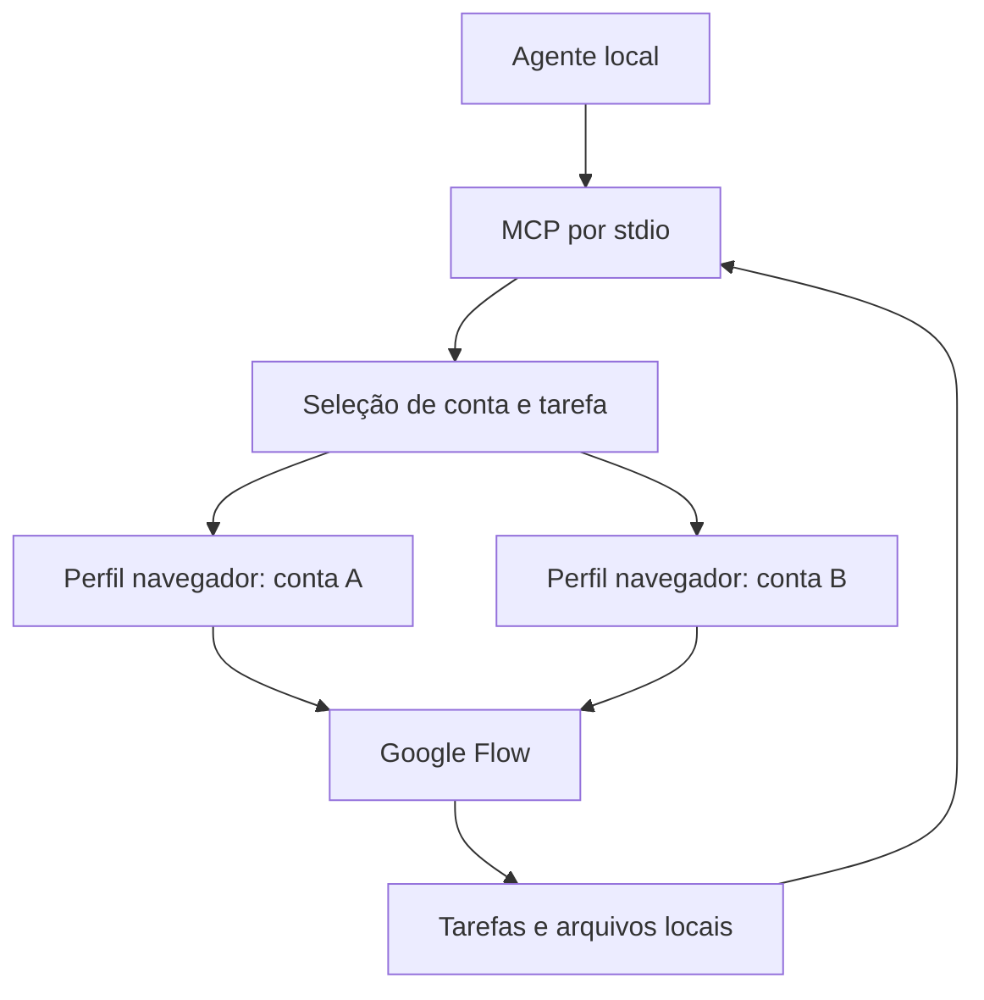

# Flow MCP independente — escopo e ferramentas

Atualizado em 30/09/2026 UTC. O MCP local oferece contas, saldo, catálogo,
projetos, upload, geração/edição de imagens e geração/recuperação de vídeos.
As operações com o backend usam HTTP; o transporte MCP permanece `stdio`.
Modelo, configuração e preço por plano vêm do catálogo HTTP, e os corpos de
upload, imagem, edição e vídeo são montados em Python. O navegador ainda prepara
a sessão e o reCAPTCHA pelo fluxo normal do Flow; seu envio de autenticação é
abortado, e a submissão nativa ocorre após fechar a página de preparo. O worker
mantém um contexto Chrome headless autenticado por conta, sob demanda, até o
encerramento do MCP. Login humano continua em janela visível.

A validação real e o orçamento atualizado estão em
[IMPLEMENTACAO-FLOW.md](docs/IMPLEMENTACAO-FLOW.md). A segunda conta e o roteamento
continuam adiados; operação sem navegador e portabilidade permanecem sem prova.
O inventário abaixo define o escopo futuro, sem afirmar cobertura integral.

## Objetivo

Oferecer aos agentes os recursos do Google Flow por MCP local, usando as contas e os créditos do usuário. Vídeo é o foco principal; imagens, edição, referências, cenas e organização fazem parte do escopo. Duas contas devem poder ser selecionadas, alternadas por disponibilidade e utilizadas em paralelo. MoneyPrinterTurbo e ChatGPT são consumidores futuros.

As fontes e restrições ficam em [recursos do Flow](docs/FLOW-RECURSOS.md), [contas e 9router](docs/9ROUTER-CONTAS.md) e [pesquisa das bases](PESQUISA-FLOW-MCP.md). A documentação do site orienta o inventário; a sessão autenticada de cada conta determina o que o MCP consegue executar.

## Caminho de uma solicitação

Reutilizar a gestão de perfis, tarefas e downloads de uma base compatível com as contas. Acrescentar apenas as operações e o roteamento que faltarem. O 9router serve de referência para seleção, prioridades e espera após limites; seu código de autenticação Gemini/Antigravity não constitui uma sessão Flow.

## Ferramentas propostas

Os nomes abaixo definem uma superfície de trabalho; não são uma lista de ferramentas já disponíveis neste projeto. Operações opcionais devem informar suporte e motivo de indisponibilidade.

| Grupo | Ferramentas propostas | Resultado útil ao agente |
| --- | --- | --- |
| Contas | `flow_list_accounts`, `flow_connect_account`, `flow_account_status`, `flow_set_routing` | Contas por apelido, sessão, saldos observados e política de escolha. Login humano em perfil dedicado. Importação/exportação por utilitário local, com validação da sessão no destino. |
| Capacidades | `flow_capabilities` | Modelos, recursos, formatos, durações, resoluções e custo observado por conta; data da observação e restrições. |
| Projetos | `flow_list_projects`, `flow_create_project`, `flow_rename_project`, `flow_delete_project` | Identidade vinculada à conta; listagem com filtro de ID/título e sinalização de resposta incompleta. Exclusão permanente exige confirmação explícita e leitura de reconciliação. |
| Preferências | `flow_get_user_settings`, `flow_update_user_settings` | Ler/atualizar preferências globais da conta; ativar retorno de vídeos silenciosos exige confirmar impacto potencial em créditos. |
| Mídia | `flow_list_assets`, `flow_search_assets`, `flow_upload_asset`, `flow_download_asset`, `flow_delete_asset`, `flow_manage_collection`, `flow_download_collection` | Arquivos, busca nos projetos conhecidos, referências e organização com identidades estáveis. Arquivamento exige confirmação; `flow_list_collections` inclui coleções vazias na primeira resposta e `flow_move_assets` confirma por leitura. Download direto e recursivo disponíveis, com paginação remota ainda não verificada. |
| Vídeo | `flow_generate_video`, `flow_edit_video`, `flow_extend_video`, `flow_upscale_media` | Gerar por texto, frames, referências de imagem ou voz pronta (voz pronta na geração validada; vídeo não suportado como referência); editar/estender/aumentar resolução quando suportado. |
| Imagem | `flow_generate_image`, `flow_edit_image` | Criar referências, variar imagens, aplicar instruções e edições localizadas quando suportadas. |
| Consistência | `flow_list_characters`, `flow_manage_character`, `flow_list_voice_presets` | Personagens/referências e presets de voz (voz pronta e personagem como ingrediente na geração validados no Windows; criação por imagem e por descrição com retrato gerado, exclusão e atualização de nome/voz/personalidade nativos de personagens validados no Windows); avatar exige participação humana quando o produto exigir captura. Trocar retrato/definir corpo e 2ª imagem pendentes. |
| Cenas | `flow_manage_scene`, `flow_export_scene` | Montar/reordenar/aparar clipes e exportar sequência. Ciclo completo (criação, leitura, inclusão, ordem, cortes, remoção, renomeação, lixeira, restauração, exclusão definitiva e exportação) validado no Windows, inclusive esvaziar a cena; paginação pendente. |
| Agente e Tools | `flow_get_agent_brief`, `flow_update_agent_brief`, `flow_list_agent_sessions`, `flow_create_agent_session`, `flow_rename_agent_session`, `flow_delete_agent_session`, `flow_agent_request`, `flow_list_tools`, `flow_run_tool` | `flow_agent_request` implementada e validada no Windows via `StreamChat` com proteções contra mutação acidental; `flow_list_tools` validado no Windows (69 applets por `ListApplets` `tRARke`); sessões (listagem, criação, renomeação e exclusão) implementadas e validadas; brief nativo (`flow_get_agent_brief` e `flow_update_agent_brief`) migrado e validado no Windows via `Zzl0ze` e `Kcr7Ub`; `flow_run_tool` planejada. |
| Execução | `flow_get_job`, `flow_wait_job`, `flow_list_jobs` | Progresso, conta original, IDs das mídias, falhas recuperáveis e arquivos baixados. |

Geração aceita `account_id` explícito ou seleção automática, projeto, prompt, modelo, proporção, duração, resolução, quantidade e referências pertinentes. Esses valores são validados contra as capacidades observadas. Não substituir silenciosamente um modelo ou modo solicitado.

Camera, áudio e demais controles devem ser parâmetros das operações compatíveis. Não inventar um endpoint independente para uma configuração que o produto só oferece dentro de outra operação. Criação/edição de Tools e exclusões de projetos/mídias podem ampliar a superfície após validação; a exclusão precisa identificar claramente a conta e os alvos autorizados.

## Múltiplas contas

Cada conta tem perfil de navegador, sessão, referências de projetos, capacidades, limites e histórico próprios. O uso de outra conta consome os créditos dela; a seleção não transfere saldo entre contas.

Três políticas atendem ao pedido:

- **Manual:** usar a conta identificada pelo agente. Se ela estiver indisponível, informar o motivo.
- **Preferência com alternância:** tentar a conta preferida e escolher outra elegível para novos pedidos quando houver esgotamento confirmado ou indisponibilidade temporária conhecida.
- **Distribuição:** encaminhar novos pedidos para contas elegíveis com capacidade livre. Iniciar com um controle do navegador por conta; duas contas podem trabalhar ao mesmo tempo.

O limite local de concorrência por conta deve ser configurável e respeitar o que o Flow efetivamente permitir. Uma janela de navegador em uma conta não deve receber comandos de dois pedidos ao mesmo tempo. O número de gerações remotas em andamento pode ter um limite distinto do controle da interface.

### Quando alternar

1. Validar os parâmetros e identificar a conta compatível antes de gerar.
2. Reservar a conta para a submissão e registrar a tarefa antes do clique que pode gastar créditos.
3. Se o Flow rejeitar por saldo insuficiente ou limite confirmado **sem aceitar a geração**, registrar a condição e avaliar outra conta elegível.
4. Se a geração foi aceita, acompanhar e baixar na conta original.
5. Se o resultado da submissão for incerto, manter estado `submission_unknown` e reconciliar a conta original. Não gerar outra cópia automaticamente.

Uma referência de mídia/projeto da conta A não deve ser tratada como referência válida na conta B. Para usar um arquivo autorizado nas duas, fazer upload separado e registrar a identidade correspondente em cada conta. Personagens, cenas e conversas também permanecem associados à conta de origem.

Saldo desconhecido é diferente de saldo zero. Leituras devem informar `observed_at`, fonte e ausência de dados. Limite de velocidade e esgotamento de créditos têm recuperações diferentes; `retry_after` ou `reset_at` só devem ser preenchidos quando conhecidos. Um bloqueio de autenticação exige ação na conta afetada.

## Gastos e recuperação

O cliente pode autorizar um orçamento concreto por pedido ou lote; essa autorização deve ser reutilizada dentro do limite, sem pedir a mesma confirmação a cada consulta de progresso. Registrar conta, quantidade, configuração, custo observado/estimado e referência da geração. Se não for possível determinar um custo confiável para cumprir o orçamento, informar essa limitação antes da submissão.

Não alterar permanentemente a preferência de aprovação do Flow como efeito colateral da conexão. Após reiniciar o MCP, recuperar as tarefas existentes e seus arquivos; falha no download não cria uma nova geração. O histórico/log não deve conter cookies, tokens ou senhas.

Cancelamento de fila local e cancelamento remoto são operações diferentes. Só expor promessa de cancelamento remoto depois de verificar que o Flow o suporta; parar polling não significa cancelar uma geração nem devolver créditos.

## Ordem de entrega

1. Conectar as duas contas e inspecionar suas interfaces/capacidades sem geração paga; comparar bases existentes com esse resultado.
2. Entregar MCP stdio, perfis isolados, seleção manual, projetos/mídia, uma geração de vídeo com tarefa persistente e download correto.
3. Entregar alternância por esgotamento confirmado e distribuição entre contas, com recuperação de submissões incertas e limites por pedido.
4. Ampliar geração/edição de imagens e vídeos, referências, extensão e upscale conforme suporte da conta.
5. Validar personagens/voz, cenas, agente e Tools; expor apenas as operações efetivamente controláveis.
6. Integrar consumidores futuros. MoneyPrinterTurbo recebe arquivos/metadados; ChatGPT usa transporte apropriado à conexão disponível.

Essa ordem entrega partes utilizáveis e mantém o inventário abrangente como destino do projeto.

## Verificação necessária

Antes de anunciar suporte: validar a operação na interface das contas. Exercitar seleção e concorrência com chamadas controladas; distinguir saldo zero, leitura indisponível, limite temporário, geração aceita e submissão incerta. Confirmar que duas tarefas em contas diferentes não misturam assets e que a recuperação não submete novamente. Um teste real de vídeo deve ter prompt, conta, configuração e gasto concretos autorizados.

Os testes locais cobrem MCP por stdio, contas, orçamento antes do envio e tarefas
persistidas. Uma conta Windows e um vídeo por texto foram validados; demais
operações, concorrência entre contas e recuperação remota continuam pendentes.

Validação de 29/09/2026 no Windows: `conta-ponte-a` retornou sessão
`authenticated` após login manual e fechamento do Chrome. A consulta de saldo
real retornou `unavailable`; o serviço de créditos do backend levantou
`AisandboxAuthError`. A integração foi ajustada para consultar o menu da conta
em `flow.google.com` nesse caso; a mesma consulta retornou `ok`, 1.050 créditos,
fonte `flow.google.com/UI`. Após autorização do usuário, um vídeo foi gerado
e baixado; ffprobe confirmou H.264/AAC, 1280×720 e 8 segundos. Custo exibido
no painel: 10 créditos; saldo final: 1.040. A opção de 4s não apareceu nessa
conta/modelo; foi usado o padrão de 8s confirmado no editor. Não há reenvio
automático de tarefas incertas nem recuperação remota implementada. O usuário
adiou a segunda conta. Os testes locais cobrem também saldo desconhecido, zero e
remoção de campos privados da resposta de créditos.

## ChatGPT no futuro

O servidor precisa ser alcançável pelo ChatGPT. A documentação atual prevê endpoint HTTPS ou Secure MCP Tunnel para conexão privada em modo desenvolvedor, conforme permissões/conta. O túnel pode manter o MCP local e conectar por HTTPS de saída; portanto, hospedagem pública não é obrigatória para toda forma de uso. Publicação pública exige endpoint HTTPS estável. [Conexão e teste](https://developers.openai.com/plugins/deploy/connect-chatgpt), [Secure MCP Tunnel](https://developers.openai.com/api/docs/guides/secure-mcp-tunnels).

Não adicionar hospedagem, OAuth ou infraestrutura remota na entrega local inicial.

## Decisões e validações pendentes

- Uso atual confirmado: Chrome no Windows. Execução em Linux/ARM64 e Raspberry Pi sem interface gráfica também faz parte do alvo do projeto.
- Interface e capacidades realmente disponíveis em cada conta, incluindo troca entre prompt padrão e agente.
- Compatibilidade de uma release fixada da base selecionada com ambas as contas.
- Cliente MCP para a primeira configuração e orçamento do primeiro teste real.

## Portabilidade e Raspberry Pi

O MCP deve receber localização de perfis e saídas por configuração, sem depender de caminhos fixos do Windows. O navegador escolhido e suas opções precisam ser validados no ambiente em uso. A autenticação pode exigir interação humana no primeiro login ou quando a sessão expirar.

O usuário deseja autenticar no PC e transferir a sessão ao Raspberry Pi, à semelhança da importação de credenciais do 9router. Esse fluxo faz parte do requisito de autenticação, mas sua viabilidade no Flow precisa de teste específico. Detalhes em [autenticação e portabilidade](docs/AUTENTICACAO-PORTABILIDADE.md).

A documentação atual do Playwright inclui Debian/Ubuntu em ARM64 e execução de navegador com interface por Xvfb no Linux. Isso oferece um caminho para operar sem monitor/desktop permanente, mas não comprova login e geração Flow em Raspberry Pi. Não assumir compatibilidade de uma versão antiga fixada da base com tudo que a versão atual do Playwright suporta. [Requisitos](https://playwright.dev/python/docs/intro#system-requirements), [Xvfb](https://playwright.dev/python/docs/ci#running-headed), [versões e ARM64](https://playwright.dev/python/docs/release-notes).

Validação específica futura: sistema de 64 bits suportado, navegador compatível, bibliotecas, login interativo temporário, duas sessões isoladas, leitura das capacidades e um vídeo autorizado. Medir memória e concorrência antes de aumentar o número de navegadores. O primeiro teste no Windows não estabelece suporte ao Raspberry Pi nem a execução totalmente headless.
